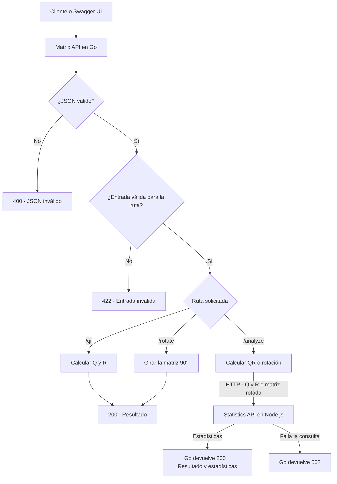

# Interseguro Coding Challenge

El proyecto implementa dos APIs. **Matrix API** (Go, Fiber y Gonum) recibe matrices y ofrece rotación de 90 grados y factorización QR. Cuando se pide un análisis, Go envía el resultado por HTTP a **Statistics API** (Node.js, Express y TypeScript), que calcula las estadísticas. Docker Compose levanta ambos servicios con un solo comando.

## Ejecutar

```sh
docker compose up --build --wait
curl http://localhost:8080/health/ready
docker compose down
```

Compose publica Go en el puerto 8080 y mantiene Node en la red interna. Copia `.env.example` a `.env` para ajustar el puerto público o el timeout. Para arrancar sin Docker, usa Go 1.26 y Node 22. En terminales separadas ejecuta `cd statistics-api && npm ci && npm run build && npm start` y `cd matrix-api && go run ./cmd/api`. Go usa `http://127.0.0.1:3000` por defecto.

En este equipo Windows, Docker Engine se verificó desde Ubuntu en WSL. Desde PowerShell y en la raíz del repo, ejecuta y deja la terminal abierta:

```powershell
wsl -d Ubuntu -u root -- systemctl start docker
wsl -d Ubuntu -u root -- docker compose up --build
```

Abre Swagger UI en otra ventana. Para detener los servicios, pulsa Ctrl+C en la terminal de Compose.

## Prueba en Swagger UI

Con los servicios levantados, abre [Swagger UI](http://localhost:8080/docs). Despliega `POST /api/v1/matrices/analyze`, pulsa **Try it out** y luego **Execute**. Puedes enviar el ejemplo precargado o editar sus números. Cambia `operation` a `rotate` para ver la rotación y sus estadísticas.

El [JSON de OpenAPI](http://localhost:8080/openapi.json) documenta ambas APIs. El endpoint de Node se consulta desde la red interna de Compose. Swagger UI carga sus archivos de interfaz desde jsDelivr y requiere internet para mostrarlos.

## Flujo de una solicitud



Las rutas de QR y rotación se resuelven en Go. La ruta de análisis añade la llamada interna a Node. Para comprobar esa conexión sin enviar una matriz, usa `GET /health/ready`.

## Operaciones

| Método y ruta | Resultado |
|---|---|
| POST /api/v1/matrices/qr | Q, R, forma de entrada y convención |
| POST /api/v1/matrices/rotate | Matriz rotada 90° en sentido horario |
| POST /api/v1/matrices/analyze | Resultado y estadísticas sobre Q y R o sobre la matriz rotada |
| POST /internal/v1/statistics | Estadísticas globales sobre las matrices recibidas, disponible en Node |
| GET /health/live | Proceso activo |
| GET /health/ready | Go devuelve 503 si Node no responde correctamente |

```sh
curl -sS http://localhost:8080/api/v1/matrices/analyze \
  -H 'Content-Type: application/json' \
  -d '{"matrix":[[1,2,3],[4,5,6]],"operation":"rotate"}'
```

Devuelve la matriz `[[4,1],[5,2],[6,3]]`, con suma 21, promedio 3.5, mínimo 1, máximo 6 y ninguna matriz diagonal. Usa `"operation":"qr"` para obtener estadísticas sobre ambos factores.

Para A de m×n, QR devuelve Q de m×k y R de k×n, con k=min(m,n). La matriz ancha usa la base ortogonal del bloque cuadrado inicial y proyecta las columnas restantes sobre esa base. Se admite rango deficiente. Los resultados conservan la precisión de punto flotante disponible. Las matrices aceptan hasta 100×100 números finitos. Una matriz cuenta como diagonal si es cuadrada y sus entradas fuera de la diagonal tienen valor absoluto ≤ 1e-9. Los índices empiezan en cero. El cuerpo está limitado a 256 KiB en Go y 512 KiB en Node.

## Pruebas y entrega

```sh
(cd matrix-api && go vet ./... && go test ./...)
(cd statistics-api && npm ci && npm run lint && npm test && npm run build)
bash scripts/smoke-compose.sh
```

Si el motor Docker no está disponible, compila Go con `go build -o matrix-api.exe ./cmd/api` desde `matrix-api`, compila Node con `npm run build` desde `statistics-api` y ejecuta `node scripts/smoke-native.mjs matrix-api/matrix-api.exe` desde la raíz.

Consulta [OpenAPI](matrix-api/internal/adapters/http/openapi.json), [decisiones](docs/ADR.md), [guía de despliegue](docs/DEPLOY.md) y [evidencia de entrega](docs/PROGRESS.md).
