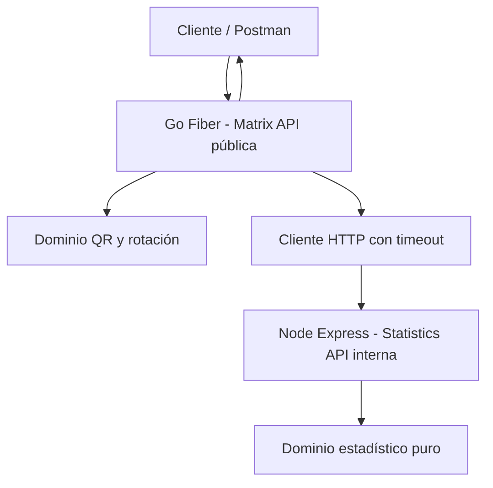

# 02 — Arquitectura y decisiones

## Estilo
**Dos servicios desacoplados con arquitectura hexagonal ligera / puertos y adaptadores**, organizados por capas (HTTP, aplicación, dominio, infraestructura). No crear una arquitectura distribuida artificial. Un monorepo facilita coordinación, trazabilidad y evaluación.

## Go/Fiber
- `cmd/api/main.go`: composición de dependencias y arranque.
- `internal/domain/matrix`: validación matemática, rotación, interfaces mínimas.
- `internal/application`: casos de uso `FactorizeQR`, `RotateMatrix`, `AnalyzeMatrix`.
- `internal/adapters/http`: rutas, DTOs, errores y middleware.
- `internal/adapters/gonum`: adaptador QR basado en Gonum.
- `internal/adapters/statistics`: cliente HTTP a Node con timeout, URL por variable de entorno y errores tipados.

## Node/Express + TypeScript
- `src/domain/statistics.ts`: funciones puras de agregación y diagonal.
- `src/application/analyze.ts`: caso de uso.
- `src/http/routes.ts`, `validation.ts`, `error-handler.ts`.
- `src/config.ts`, `src/server.ts`, `src/app.ts` para facilitar pruebas.
- Validación de payload con Zod o equivalente ligero.

## Principios
- SRP: handlers no realizan álgebra ni estadísticas.
- DIP: caso de uso Go depende de interfaz para cliente de estadísticas; adaptador concreto HTTP.
- OCP: separar operaciones sin switch gigante; evitar interfaces de un solo uso sin beneficio.
- DRY, KISS, errores explícitos, configuración por entorno, inyección por constructor.
- Patrones justificados: Adapter (Gonum, HTTP), Strategy solo si existen varias implementaciones genuinas, Composition Root en main. No introducir Repository sin persistencia.

## Operación y seguridad
- Go es el punto de entrada público. Node se mantiene interno si la plataforma permite red privada. Si se expone, documentar mitigación y no presentar esa configuración como privada.
- Limitar dimensiones, elementos, tamaño de cuerpo y tiempo de cálculo; prevenir matrices gigantes que consuman CPU/RAM.
- `GET /health/live` y `GET /health/ready`; readiness puede comprobar configuración y dependencia con límites de tiempo.
- Timeout entre servicios (p.ej. 3 s configurable), sin reintentos automáticos de POST para no duplicar carga; errores 502/503.
- HTTPS provisto por plataforma, contenedores sin root, imágenes pequeñas, dependencias fijadas.
- Sin Redis ni DB: las operaciones son deterministas y no requieren estado ni almacenamiento.

## Decisiones ADR
ADR-001: monorepo y dos servicios independientes. ADR-002: hexagonal ligera. ADR-003: HTTP síncrono sin gateway. ADR-004: QR y rotación como operaciones distintas. ADR-005: no persistencia/caché. ADR-006: despliegue en plataforma administrada con Docker.
